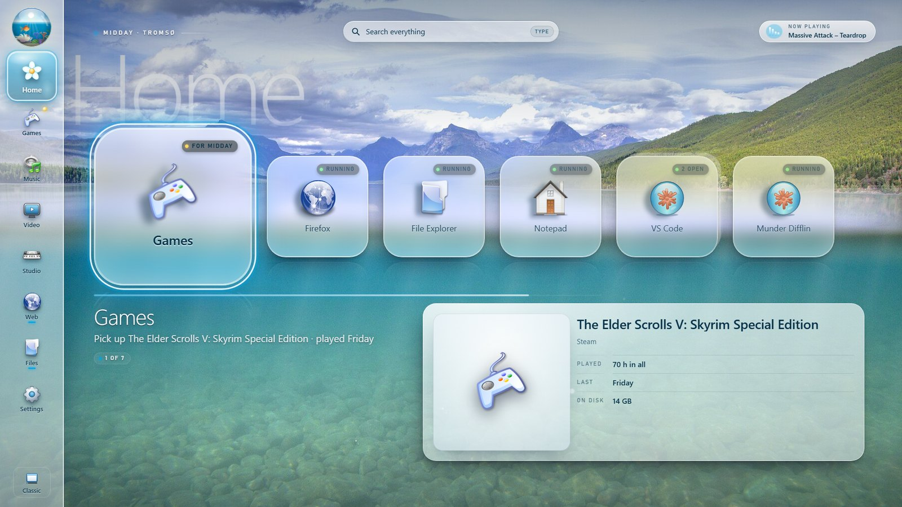
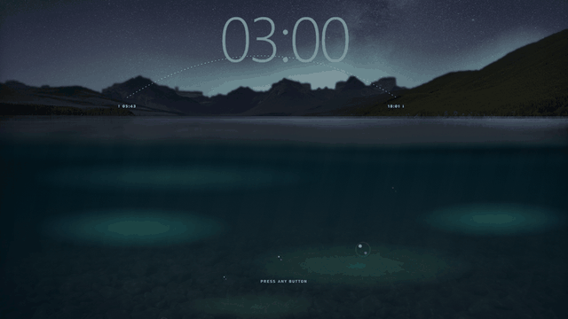
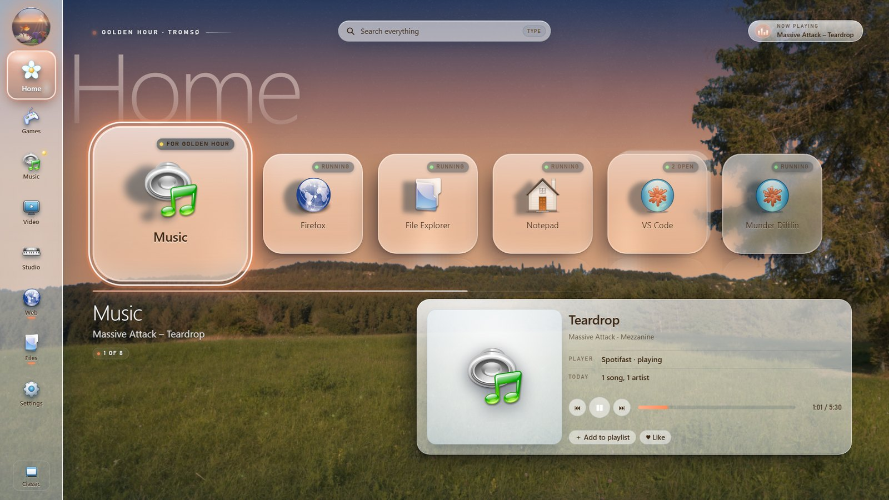
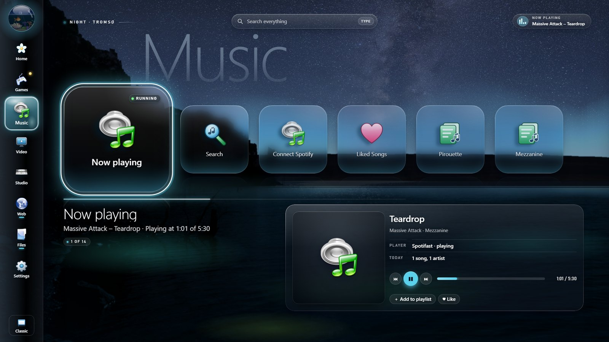
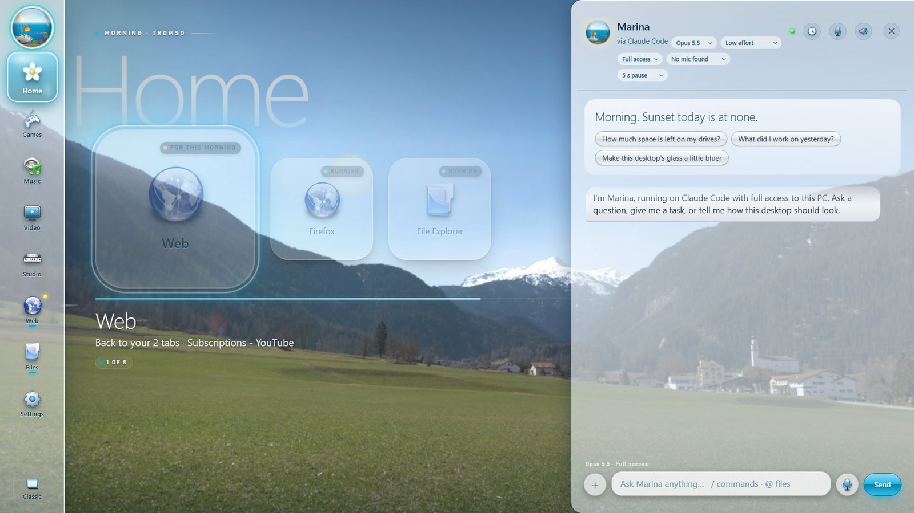
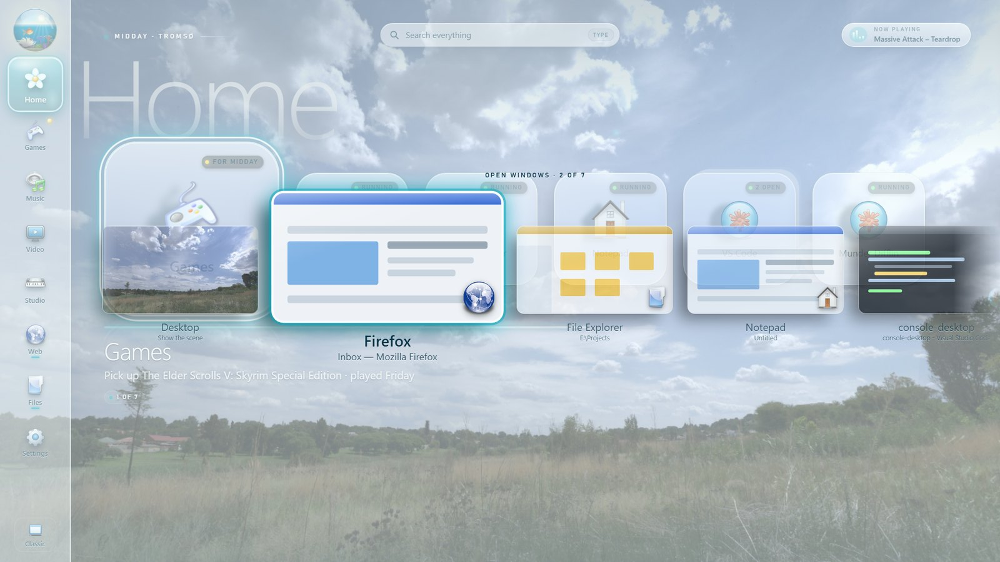

<div align="center">

# 🐠 Tidepool

### *Your Windows desktop, but it's a console, and it's 2007, and the sun is real.*

[](../../releases)
[](../../releases)
[](https://dotnet.microsoft.com/download/dotnet/8.0)
[](LICENSE)



**Glossy Frutiger Aero glass · photo scenes that follow the real sun · a goldfish who can restyle your desktop**

[**⬇ Download**](../../releases) · [What it does](#-what-it-does) · [Escape hatch](#-getting-back-to-normal-windows) · [Build it](#-build-from-source)

</div>

---

> [!WARNING]
> **Early access.** Tidepool works, but it's young. Expect rough edges, the odd bug, and things changing between versions.

Tidepool replaces the Windows desktop with a console-style one. Drive it with a **keyboard, a mouse or a controller**.
It runs as a layer on top of Explorer: it changes nothing permanent, and one hotkey always takes you back to stock Windows.
No registry surgery, no shell replacement, no regrets.

## ☀️ A desktop with a day

The scenery isn't a wallpaper, it's a clock. Lake, shore, hill, meadow and valley photos get tinted by the actual time of day where you live:
dawn blushes pink, noon goes bright aqua, golden hour glows, and at night the stars come out and the water starts to shimmer.

<div align="center">

<br><sub>One day on the lake scene, sped up a little.</sub>
</div>

<table>
<tr>
<td width="50%"></td>
<td width="50%"></td>
</tr>
<tr>
<td align="center"><sub><b>Golden hour.</b> The glass takes the colour of the sky.</sub></td>
<td align="center"><sub><b>Music at night.</b> Whatever you play rises as light over the horizon.</sub></td>
</tr>
</table>

## ✨ What it does

| | |
|---|---|
| 🎮 **One menu for everything** | Games (Steam and Epic libraries), Music, Video, Studio, Web, Files and Settings, in one console-style row. |
| 🎵 **Your own apps** | Music works with any player (Spotify, TIDAL, Apple Music, YouTube Music and more). Web uses any browser. Studio works with any DAW, or switch it off. Video searches and plays YouTube through yt-dlp, with no ads. |
| 🐟 **Marina** | A little goldfish in a reef bowl, top-left. She chats through Claude Code or any AI API (OpenAI, Claude API, OpenRouter, Gemini, Ollama, LM Studio and more). Type to her or say *"Hey Marina"*. Ask her to restyle the desktop and the change shows up live. |
| 🌄 **Living scenes** | Five photo scenes, tinted by the real sun where you live. Music draws a glowing visualizer over the horizon. |
| 📼 **Winamp skins** | Hand-picked classic skins for the music player. Yes, really. |
| 🪟 **Window switcher** | Glossy cards for every open window. Works across two screens. |

<table>
<tr>
<td width="50%"></td>
<td width="50%"></td>
</tr>
<tr>
<td align="center"><sub><b>Marina</b>, ready to answer questions, run tasks or make the glass "a little bluer".</sub></td>
<td align="center"><sub><b>The switcher.</b> Every window, one glossy row.</sub></td>
</tr>
</table>

<sub>Screenshots come from the page's built-in preview with made-up windows and songs.</sub>

## 📦 Install

1. Download `ConsoleDesktop-Setup.exe` from [**Releases**](../../releases).
2. Run it. It installs for your user only, so no admin is needed. If WebView2 is missing, the installer fetches it.
3. Setup opens next. Pick your player, browser, DAW and chat. You can change these later in **Settings › Setup**.

> [!NOTE]
> Windows may warn that the installer is unsigned. Click **More info › Run anyway**.

**Requirements:** Windows 10 or 11, 64-bit. Optional: [yt-dlp](https://github.com/yt-dlp/yt-dlp) for Video, and
[Claude Code](https://claude.com/claude-code) or an API key for Marina. Setup can download yt-dlp for you.

## 🛟 Getting back to normal Windows

Panic is never required. Any of these works:

- ⌨️ **Ctrl+Alt+Win+S**, which works even if Tidepool hangs.
- 📋 Start menu › Console Desktop › **Back to stock Windows**.
- 💤 Nothing at all: if Tidepool crashes or stops answering for about 3 seconds, the taskbar comes back by itself.

To remove Tidepool, use Start menu › Console Desktop › **Uninstall**, or Settings › Apps.

## 🪸 Known limits

- Maximised windows stop where the hidden taskbar used to be.
- Desktop icons draw over the scene.
- Read-aloud uses Windows' built-in voice. Kokoro voices (`tts/say.py`) are not bundled.
- So far it has only been tested on the developer's PC. Bug reports are very welcome under [**Issues**](../../issues).

## 🔧 Build from source

You need the [.NET 8 SDK](https://dotnet.microsoft.com/download/dotnet/8.0).

```powershell
dotnet build src -c Release -o bin
bin\ConsoleDesktop.exe                 # starts the watchdog and the desktop
bin\ConsoleDesktop.exe --stock         # the escape hatch from a shell
powershell -ExecutionPolicy Bypass -File installer\build.ps1 -Version 0.2.4   # makes dist\ConsoleDesktop-Setup.exe
```

- `src/` holds the C#/.NET 8 + WebView2 host, and `web/` holds the page (`web/index.html`).
- `BRIDGE.md` describes the contract between the page and the host.
- `web/live/` holds the restyling files Marina edits, and its `README.md` explains every key.
- Set `CD_DEBUG_PORT=9340` before starting to get a DevTools port.
- Open `web/index.html?dev` in a browser to preview any state without the host (F1 opens the state menu).

## 📜 License

The code is MIT (see [LICENSE](LICENSE)). The images keep their own licences, listed in [`web/assets/CREDITS.md`](web/assets/CREDITS.md):
the icons are Crystal Clear (LGPL), the scenes come from Poly Haven HDRIs (CC0), and the Winamp skins are from the Winamp Skin Museum.

<div align="center">
<br>
<sub>Made with too much glass and one very small fish. 🫧</sub>
</div>
